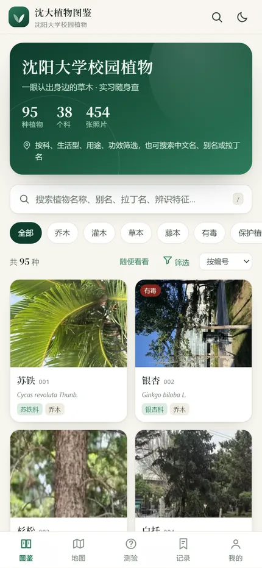
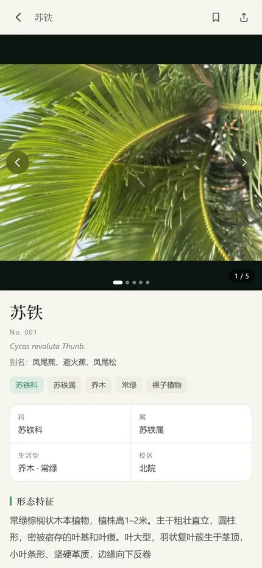
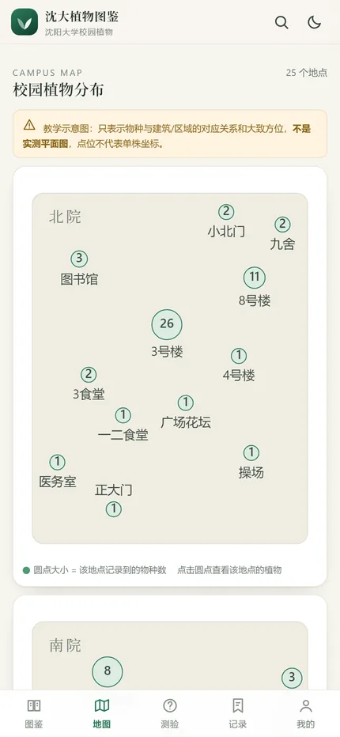

# 沈阳大学校园植物图鉴

> 一个给校园植物识别和植物学实习用的纯静态网页应用。收录沈阳大学校园植物 **95 种**、照片 **454 张**，支持检索、筛选、校园分布、看图识种测验、观察记录与离线使用。

- 仓库：<https://github.com/caobo123caobo/syu-campus-plants>
- 在线访问（启用 GitHub Pages 后）：<https://caobo123caobo.github.io/syu-campus-plants/>





---

## 功能

**图鉴与检索**

- 95 种植物卡片式浏览，支持中文名、别名、科名、属名、拉丁名、正文关键字检索
- 多词检索为 AND 关系（例如「松科 乔木」）
- 按科（38 个）、生活型、用途、药用功效、校区、有毒/保护/裸子植物筛选
- 排序：按编号 / 按名称（拼音序）/ 按科 / 按图片数

**物种详情**

- 多图轮播 + 全屏看图（支持滑动、键盘方向键）
- 原文形态特征、生态习性、价值功用、校园位置
- 生活型、用途、功效等标签，附「依据原文片段」可展开核对
- 同科植物推荐、上一种/下一种、复制链接分享

**校园分布**

- 北院 / 南院两张示意图，按建筑与区域标注 25 个地点
- 圆点大小表示该地点记录到的物种数，点击查看该地点的植物
- 明确标注「示意图，不是实测平面图」

**测验与复习**

- 6 种题型：看图识种、名称→科、名称→拉丁名、特征辨种、别名辨种、功效辨种
- 范围：全部 / 我的收藏 / 未掌握 / 指定科；10·20·30 题
- 自动判分、错题本、错题重练、正确率与最高分统计

**个人功能**

- 收藏、已浏览、已掌握标记
- 观察记录：拍照（浏览器端压缩）+ 地点 + 备注，存本机 IndexedDB，可导出 JSON
- 学习打卡日历、连续天数、学习进度
- 深色模式、离线可用（Service Worker + PWA，可添加到主屏幕）

---

## 技术栈

- 原生 HTML / CSS / JavaScript（ES Modules），**零构建、零依赖、无后端**
- 数据为静态 JSON，图片为 WebP（三档：原图 / 缩略图 / LQIP 占位）
- PWA：`manifest.webmanifest` + `sw.js`（应用外壳预缓存、图片按需缓存）
- 可直接部署到 GitHub Pages / Gitee Pages / 任意静态托管

## 目录结构

```
├── index.html                # 单页入口
├── manifest.webmanifest      # PWA 清单
├── sw.js                     # Service Worker（离线缓存）
├── assets/
│   ├── css/app.css           # 全部样式
│   ├── js/                   # 应用代码（模块化）
│   │   ├── app.js            # 入口、路由、主题
│   │   ├── data.js           # 数据加载与索引
│   │   ├── search.js         # 检索与筛选
│   │   ├── store.js          # 收藏/进度/设置/IndexedDB 记录
│   │   ├── ui.js             # 卡片、图库、面板等组件
│   │   ├── util.js           # 工具函数与图标
│   │   └── views/            # 各页面
│   └── icons/                # 应用图标
├── data/
│   ├── plants.json           # 95 种植物数据（含图片、标签、依据）
│   └── site.json             # 站点配置、科列表、地点坐标、数据订正记录
├── images/<编号>/            # 每物种图片：nn.webp（大图）、nns.webp（缩略图）
├── scripts/                  # 数据处理与校验脚本
└── docs/                     # 复核清单、添加植物、数据字典、部署说明
```

## 本地运行

纯静态站点，需要一个本地 HTTP 服务（不能直接双击 `index.html`，因为浏览器会拦截 `fetch` 本地 JSON）：

```bash
# 方式一：仓库自带（需要 Node 18+）
node scripts/serve.mjs 4321
# 打开 http://127.0.0.1:4321/

# 方式二：Python
python -m http.server 4321
```

### 校验与测试

```bash
node scripts/validate.mjs      # 数据字段、图片文件、引用完整性
node scripts/check-imports.mjs # ES Module 导入/导出一致性
node scripts/test-logic.mjs    # 检索、筛选、排序逻辑（无需浏览器）
node scripts/cdp-check.mjs     # 用本机 Chrome 渲染各页面并截图（需要 Chrome）
node scripts/cdp-flows.mjs     # 端到端交互：搜索、收藏、记录、测验、地图
```

## 部署到 GitHub Pages

1. 新建仓库并推送本目录（`_source/`、`_shots/`、`_debug/` 已在 `.gitignore` 中排除）
2. 仓库 **Settings → Pages**，Source 选 `Deploy from a branch`，分支 `main`、目录 `/ (root)`
3. 等待 Actions 完成，访问 `https://<用户名>.github.io/<仓库名>/`

已包含 `.nojekyll`，避免 GitHub Pages 的 Jekyll 处理；全部资源使用相对路径，放在子目录也能正常运行。

详细说明见 [docs/deploy-github-pages.md](docs/deploy-github-pages.md)。

## 后续添加植物

依次：

1. 把照片放进 `images/<新编号>/`（或直接用脚本转换）
2. 在 `data/plants.json` 追加一条记录（字段见 [docs/data-dictionary.md](docs/data-dictionary.md)）
3. 运行 `node scripts/validate.mjs` 自检
4. 若是新科，把它加进 `data/site.json` 的 `families`

也可以用脚本半自动完成：

```bash
python scripts/add_plant.py --name 白蜡 --latin "Fraxinus chinensis Roxb." \
  --family 木樨科 --genus 白蜡属 --location "北院8号楼旁" \
  --images "D:/photo1.jpg,D:/photo2.jpg"
```

完整步骤与注意事项见 [docs/adding-plants.md](docs/adding-plants.md)。

## 数据说明（重要）

- 正文（别名、形态特征、生态习性、价值功用、校园位置）**原样来自校园植物名录**（《11.11校园植物》文档），未改写、未润色、未补写。
- 生活型、常绿/落叶、用途、功效、花期、果期等标签由原文关键词自动提取；每条依据都能在详情页展开查看，也保存在 `data/plants.json` 的 `derived` 字段。
- 科名订正 **24 处**：原文中的「蔷薇亚目科」「桔梗目科」「牛栓藤科」等不是规范科名或属于误标，已按属的归属改正，逐条理由见 [docs/data-review.md](docs/data-review.md)。未做 APG 大合并，保持教材通行科名。
- 中文名笔误订正 **2 处**：衫松 → 杉松、顿萼附地菜 → 钝萼附地菜，依据拉丁名与原文描述，详情页会标注原文写法。
- 原文未写的内容（例如 2 种无生态习性段落、8 种未明示生活型、11 种只记录到校区）在页面上显示「原文未载」，**没有编造**。
- 地图为教学示意图，点位只表示所属建筑/区域，不是植株实测坐标。

## 已知限制

- 检索暂不支持拼音/首字母（缺少离线拼音数据）；按名称排序使用浏览器中文排序（拼音序）。
- 图片总量约 27 MB（454 张 ×2 档）。列表页只加载缩略图并懒加载，详情页按需加载大图；如需更小体积可下调 `scripts/build_images.py` 中的质量参数重新生成。
- 11 种植物在原文中只写到「北院/南院」，无法落到具体地点，地图页单独列出。
- 观察记录只存在本机浏览器，换设备或清理浏览器数据会丢失（可导出 JSON 备份）。

## 免责声明

本应用仅用于校园植物识别与植物学教学，所有药用记载为名录原文的学术参考，**不构成任何医疗诊断、治疗、用药或食用建议**。野外植物存在误认风险，请勿依据本应用采食或药用。如有健康问题，请咨询专业医疗人员。

图片来自校园植物名录文档，版权归原作者/拍摄者所有，仅用于教学识别；如涉侵权请联系删除。

## 许可证

| 内容 | 许可 |
|---|---|
| 代码（`assets/js`、`assets/css`、`scripts`、`sw.js` 等） | **MIT**，见 [LICENSE](LICENSE) |
| 文字与整理数据（`data/*.json`、`docs/`、页面文案） | **CC BY-NC-SA 4.0**，见 [LICENSE-CONTENT.md](LICENSE-CONTENT.md) |
| 照片与图标（`images/`） | 版权归原拍摄者，仅授权用于本项目的教学识别，**不随本项目再许可** |

简单说：代码可以自由使用和修改；整理的文字与数据允许署名、非商业地复用，但再分发需保持相同许可；照片请勿商用或二次授权。

物种正文整理自《沈阳大学校园植物》名录文档，引用或再分发时请一并注明原文档来源。版权人署名如需改为个人姓名，请修改 `LICENSE` 第一段。

## 更新记录

- **v1.0（2026-11-15）**：首版。95 种植物、454 张照片；图鉴检索、筛选、详情、校园分布示意图、6 类题型测验、错题本、收藏与掌握、观察记录、打卡、深色模式、离线 PWA。
